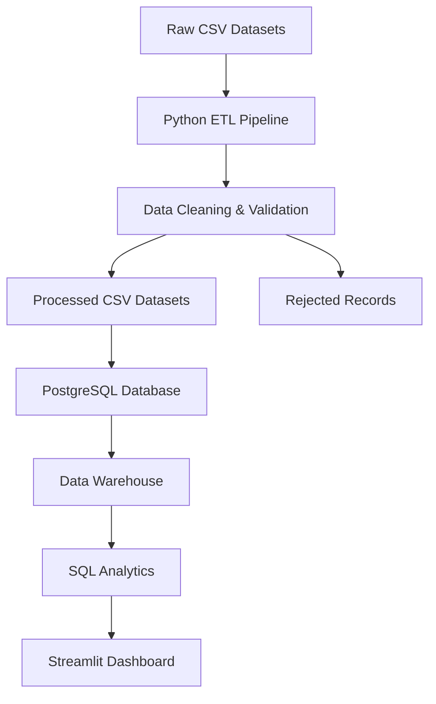

# 📊 OrderLens — Retail Data Engineering & Analytics Platform

<p align="center">
  <strong>An end-to-end retail data pipeline built with Python, Pandas, PostgreSQL and Streamlit.</strong>
</p>

<p align="center">
  
  
  
  
  
  
</p>

---

## 📌 Overview

**OrderLens** is an end-to-end retail data engineering and analytics project that transforms raw transactional datasets into structured, analytics-ready data.

The project demonstrates a practical data pipeline involving data generation, extraction, cleaning, validation, transformation, database loading, SQL analytics and interactive visualization.

OrderLens processes retail customers, products and orders data to generate insights into sales performance, revenue trends, product categories, customer activity and geographical distribution.

---

## 🏗️ Architecture



---

## 🛠️ Tech Stack

| Technology | Purpose |
|---|---|
| Python | ETL and data processing |
| Pandas | Data transformation and validation |
| PostgreSQL | Relational database |
| SQL | Analytics and querying |
| Streamlit | Interactive dashboard |
| Plotly | Data visualization |
| Pytest | Automated testing |
| Git | Version control |

---

## 📂 Project Structure

```text
OrderLens/
├── data/
│   ├── raw/
│   │   ├── customers.csv
│   │   ├── products.csv
│   │   └── orders.csv
│   └── processed/
│       ├── customers.csv
│       ├── customers_rejected.csv
│       ├── products.csv
│       ├── products_rejected.csv
│       ├── orders.csv
│       └── orders_rejected.csv
├── docs/
├── logs/
├── sql/
│   ├── analytics.sql
│   ├── schema.sql
│   └── warehouse.sql
├── src/
│   ├── dashboard.py
│   ├── db.py
│   ├── etl.py
│   ├── generate_data.py
│   └── load_data.py
├── tests/
│   └── test_data_quality.py
├── .gitignore
├── README.md
└── requirements.txt
```

---

## 📦 Dataset

OrderLens uses synthetic retail datasets generated programmatically.

| Dataset | Records |
|---|---:|
| Customers | 500 |
| Products | 100 |
| Orders | 10,000 |

The datasets simulate retail transactional data for pipeline development, data validation and analytical reporting.

---

## ⚙️ Pipeline Components

### 1. Data Generation

Generates synthetic retail datasets containing:

- Customer information
- Product information
- Order transactions

The generator provides reproducible datasets for development and testing.

### 2. Data Extraction, Transformation & Validation

The ETL pipeline performs:

- Column name normalization
- Data cleaning and standardization
- Duplicate record handling
- Required field validation
- Customer data validation
- Product data validation
- Order data validation
- Data type conversion
- Invalid record rejection
- Processed dataset generation
- ETL logging

Invalid records are separated into rejection datasets for inspection.

### 3. PostgreSQL Database

PostgreSQL is used to store structured retail data and support analytical queries.

The project includes SQL scripts for database schema creation and warehouse modelling.

### 4. SQL Analytics

SQL queries support analytical operations including:

- Revenue calculations
- Order metrics
- Average Order Value (AOV)
- Product category analysis
- Monthly sales analysis
- Customer performance analysis

---

## 📊 Dashboard Features

The interactive Streamlit dashboard provides the following sections:

### Overview

- Revenue overview
- Total orders
- Average Order Value
- Customer metrics
- Revenue trends
- Category performance
- Geographical sales insights

### Sales Analytics

- Revenue analysis
- Sales trends
- Category-level performance
- City-level performance
- Interactive analytical visualizations

### Data Quality

- Dataset-level validation information
- Data quality metrics
- Validation summaries
- Data inspection

### Data Explorer

- Explore orders, customers and products
- Interactive tabular data
- CSV export functionality

---

## 🧪 Testing

OrderLens uses Pytest for automated data quality testing.

The test suite validates:

- Customer data integrity
- Customer uniqueness
- Customer email completeness
- Product data integrity
- Product price validation
- Order data integrity
- Order uniqueness
- Positive order quantities
- Non-negative order amounts
- Valid order dates

Run the tests:

```bash
pytest -v
```

---

## 🚀 Installation & Setup

### 1. Clone the repository

```bash
git clone https://github.com/Nitesh0717/OrderLens.git
cd OrderLens
```

### 2. Create a virtual environment

```bash
python -m venv .venv
```

Activate it:

**Linux/macOS**

```bash
source .venv/bin/activate
```

### 3. Install dependencies

```bash
pip install -r requirements.txt
```

### 4. Configure the database

Configure the PostgreSQL database connection using the project's environment configuration.

### 5. Generate datasets

```bash
python src/generate_data.py
```

### 6. Run ETL

```bash
python src/etl.py
```

### 7. Load processed data

```bash
python src/load_data.py
```

### 8. Create warehouse tables

```bash
psql -U YOUR_DB_USER -d YOUR_DB_NAME -f sql/warehouse.sql
```

### 9. Refresh the data warehouse

```bash
python src/load_warehouse.py
```

### 10. Run tests

```bash
pytest -v
```

### 11. Launch the dashboard

```bash
streamlit run src/dashboard.py
```

---

## 📈 Analytics

OrderLens enables analysis of retail data through:

- Revenue and order performance
- Monthly revenue trends
- Product category performance
- Customer activity
- Geographical sales distribution
- Transaction-level data exploration

---

## 🎯 Project Objectives

- Build an end-to-end data engineering workflow
- Implement ETL processes using Python and Pandas
- Apply practical data quality validation
- Work with relational databases and PostgreSQL
- Implement SQL-based analytics
- Explore data warehouse concepts
- Develop interactive business analytics dashboards
- Build a reproducible data processing workflow

---


## 🐳 Docker Deployment

### Prerequisites
- Docker
- Docker Compose

### Start the application
```bash
 git clone https://github.com/Nitesh0717/OrderLens.git
 cd OrderLens
 docker compose up --build -d
```

### Load the data warehouse
```bash
 docker compose exec dashboard python src/load_warehouse.py
```

### Access the dashboard
http://localhost:8501

### Run tests
```bash
 docker compose exec dashboard pytest -v
```

### Stop containers
```bash
 docker compose down
```

> PostgreSQL data persists in a Docker volume. `docker compose down -v` deletes persisted database data.

---
## 🔮 Future Improvements

- Automated ETL scheduling
- Incremental data loading
- CI/CD pipeline integration
- Advanced analytics
- Sales forecasting
- Cloud deployment

---

<p align="center">
  <strong>OrderLens — Turning Retail Data into Actionable Insights.</strong>
</p>
